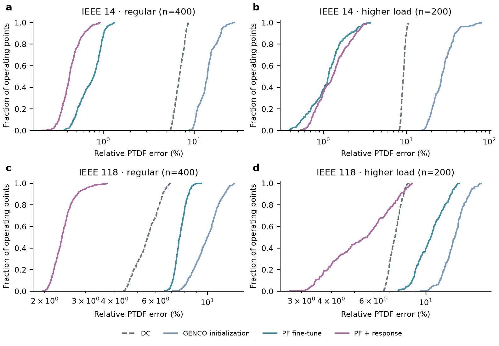
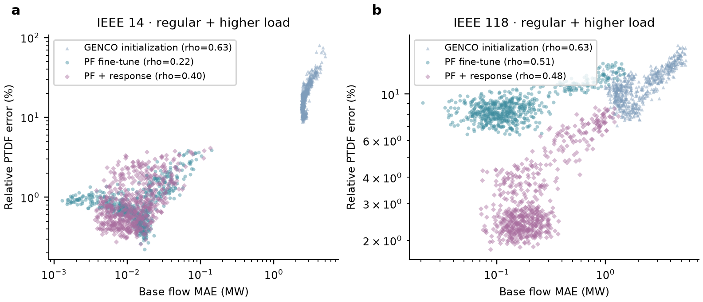
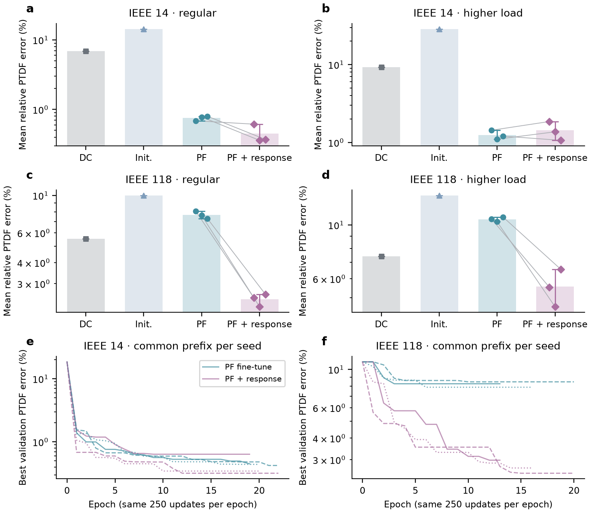
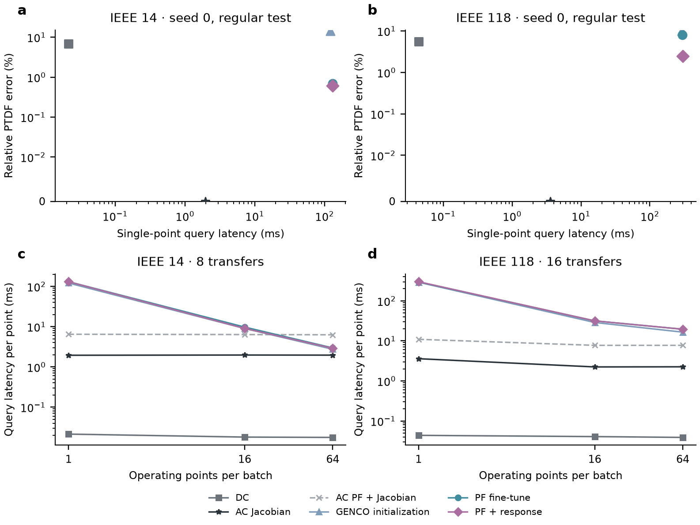

# GENCO-PTDF: testing and improving AC power-flow derivatives

**Entrant:** PowerUp (individual entry), Independent.
**Contact:** bin@smu.edu.
**Code:** https://github.com/BinHuangScut/genco-ptdf.
**Models, data and figure archives:** https://github.com/BinHuangScut/genco-ptdf/releases/tag/v0.1.0.
See [the concise Community entry](challenge_entry.md) and [artifact downloads](release.md).

## Research question and contribution

An accurate power-flow surrogate is not automatically an accurate local sensitivity
surrogate. We evaluate the derivative of the official GENCO Small models and test
whether a small amount of local transfer-response supervision improves AC-PTDF
accuracy beyond ordinary PF fine-tuning with the same extra state labels.

The effect of response supervision is mixed: it does not improve every grid/distribution comparison. Relative error reductions versus PF (positive is better): case14_ieee test: +40.6%; case14_ieee stress: -14.7%; case118_ieee test: +68.4%; case118_ieee stress: +47.4%.
These are measured outcomes on this fixed-control benchmark, not a universal
guarantee. No speedup is assumed: we benchmark a cached sparse classical method.

## GENCO and OpenGridFM usage

We use official Small/seed0 IEEE14 and IEEE118 checkpoints and their per-grid
normalization statistics, pinned to Hugging Face revision
`7014f145635f26fa29e9e003f0dc33f689d615da`. GraphKit is pinned to
`95b90eecc7f5c2c86a9dd776f0c3f40434def22f`; DataKit to
`316c4afeb1b1d048b6ccaa6135fbc54e00549f64`. We retain upstream implementation
unchanged and put the PF boundary adapter and derivative APIs in a separate package.
DataKit supplies corrected networks and admittance/branch utilities. Our uniform
load sampler and balanced proportional dispatch are an extension, rather than the
official OPF-generated dataset. Official models are trained per grid; we do not
claim unseen-topology foundation-model generalization.

## Definition and experimental design

For a transfer a→b, AC-PTDF is dP_from/dt at t=0, in MW/MW. Net injection at a
increases by t MW and at b decreases by t MW, with Qd, PQ/PV types, PV/reference
voltage setpoints, reference angle, transformer taps and phase shifts fixed.
The reference generator balances incremental AC losses. At PV source nodes the
generator mapping uses Pmax shares; other coordinates use constant-Q load changes.

Each grid has 2000/400/400 training/validation/test operating points plus 200
higher-load test points. Global regular-load multipliers are 0.8–1.2; higher-load
multipliers 1.2–1.4; independent local Pd/Qd multipliers 0.9–1.1. Scheduled Pg uses
base Pg shares normalized to demand plus a fixed 3% loss allowance; actual reference
Pg follows AC balance. A base point and all eight paired perturbation states stay
in one split. Hashes, group IDs and failed solves are saved.

Five methods are compared: DC, converged-point AC Jacobian, official GENCO
initialization with the common boundary adapter, ordinary PF fine-tuning, and PF
plus response fine-tuning. Before masking, the adapter retains given voltage
setpoints and treats reference Vm as known. It never reads solved voltage labels
as inputs. Both fine-tuning arms see identical base/perturbed state supervision,
seed-specific order, and maximum update budget. Responses use ±0.1 and ±1 MW
central secants; PF training retains official masked state and layered physics
losses. AdamW lr=1e-4, batch=8 groups (24 graphs), weight=1, max=100 epochs,
patience=10, seeds=0,1,42. The best checkpoint minimizes AD PTDF error on all 400
validation points ×4 directions. Independent early stopping can change actual
update counts. Full configurations and per-epoch histories are provided.
Figure3 also compares cumulative-best validation errors within each paired seed's
common observed update prefix. This is an equal-update validation diagnostic;
the final held-out comparison still uses each arm's own early stopping. Consequently
we do not claim the final comparison fully eliminates actual-update-count effects.

## Numerical validation

The final solver directly calls pandapower's Newton-Raphson kernel with cached
DataKit admittance matrices. Classical Jacobians are rebuilt at converged states
and factorized once per point. Stored labels were originally generated by an
equivalent sparse Newton loop; all 6,000 base states/full labels and 48,000 paired
state residuals are certified against the final solver, with results in
`results/validation/pandapower_dataset.json`. Final classical timings are remeasured.
IEEE14/118 derivatives agree with high-precision central differences. An independent
pandapower Newton solver agrees with the voltage solution. GENCO block reverse AD
agrees with directional AD and convergent double-precision model finite differences.
Finite steps can cross LeakyReLU boundaries, so we record the step sweep rather
than treating one large step as a derivative. Tests check units, direction, taps,
phase shifts, reference balancing, multiple generators, masks, target isolation,
group splits and capture/eager objective equivalence.

## Results

The transaction test covers all 400 regular and 200 higher-load operating points
per grid. Fine-tuning entries report the mean ± sample standard deviation across
three training seeds of the per-point metric averages. Sign agreement uses
|Htrue|≥1e-3. The +5 MW increment is an unseen perturbation size and excludes base
flow intercept error. The classical method supplies the reference.

| Grid | Set | Method | PTDF relative (%) | PTDF MAE | Sign agreement (%) | +5 MW delta MAE (MW) |
| --- | --- | --- | --- | --- | --- | --- |
| IEEE 14 | test | DC | 6.931 | 0.01172 | 99.60 | 0.0458 |
| IEEE 14 | test | GENCO initialization | 14.371 | 0.01997 | 97.35 | 0.1076 |
| IEEE 14 | test | PF fine-tune | 0.755 ± 0.060 | 0.00101 | 99.89 | 0.0029 |
| IEEE 14 | test | PF + response | 0.448 ± 0.144 | 0.00071 | 99.99 | 0.0033 |
| IEEE 14 | stress | DC | 9.223 | 0.01557 | 99.34 | 0.0643 |
| IEEE 14 | stress | GENCO initialization | 28.690 | 0.04446 | 91.27 | 0.2782 |
| IEEE 14 | stress | PF fine-tune | 1.246 ± 0.169 | 0.00198 | 100.00 | 0.0114 |
| IEEE 14 | stress | PF + response | 1.430 ± 0.400 | 0.00220 | 99.91 | 0.0105 |
| IEEE 118 | test | DC | 5.545 | 0.00294 | 99.34 | 0.0117 |
| IEEE 118 | test | GENCO initialization | 10.003 | 0.00584 | 94.68 | 0.0285 |
| IEEE 118 | test | PF fine-tune | 7.653 ± 0.383 | 0.00420 | 96.51 | 0.0119 |
| IEEE 118 | test | PF + response | 2.418 ± 0.210 | 0.00167 | 98.74 | 0.0060 |
| IEEE 118 | stress | DC | 7.416 | 0.00392 | 98.99 | 0.0158 |
| IEEE 118 | stress | GENCO initialization | 13.249 | 0.00716 | 94.16 | 0.0283 |
| IEEE 118 | stress | PF fine-tune | 10.565 ± 0.243 | 0.00561 | 96.20 | 0.0111 |
| IEEE 118 | stress | PF + response | 5.562 ± 0.982 | 0.00346 | 97.31 | 0.0117 |

Complete non-reference injection matrices are additionally evaluated on 16 regular
and 16 higher-load points per grid using block reverse AD. Source tables report
this subset separately; it is not the full 600-point transaction test. Flow versus
derivative correlations are descriptive and are available with the source data.
No statistical significance claim is made from three seeds.

Complete-basis relative errors (subset; mean ± seed SD):

| Grid | Set | DC (%) | GENCO initialization (%) | PF fine-tune (%) | PF + response (%) |
| --- | --- | --- | --- | --- | --- |
| case14_ieee | test | 8.536 | 14.602 | 2.708 ± 0.067 | 2.876 ± 0.558 |
| case14_ieee | stress | 11.856 | 21.555 | 1.825 ± 0.154 | 2.239 ± 0.104 |
| case118_ieee | test | 7.282 | 28.363 | 25.902 ± 0.684 | 24.753 ± 1.052 |
| case118_ieee | stress | 9.831 | 29.344 | 27.609 ± 0.209 | 27.832 ± 0.721 |

## Runtime and memory

RTX 4080 SUPER 16 GB and WSL Ubuntu/Python3.12 are used. Models use float32 on GPU;
classical solvers float64 on CPU. Dynamic graph preparation and CPU-result transfer
are included; checkpoint loading and static network setup are excluded. We reuse
Y matrices, the DC LU, and each point's AC Jacobian LU across transaction columns.
GPU completion is synchronized; 20 repeated measurements follow warm-up, including
CUDA graph capture for the fixed-shape directional AD queries. Full matrices use
block reverse AD. Both allocated and reserved GPU peaks are recorded.
Derivative-only AC and PF+derivative costs are separate. Batch sizes1,16,64 and
full-matrix single-point times are in the timing source tables.

| Grid | Method | ms / point | Peak GPU MiB |
| --- | --- | --- | --- |
| case14_ieee | GENCO initialization | 121.538 | 55.8 |
| case14_ieee | PF fine-tune | 131.138 | 120.8 |
| case14_ieee | PF + response | 130.987 | 169.6 |
| case14_ieee | DC | 0.021 | 0.0 |
| case14_ieee | AC Jacobian | 1.947 | 0.0 |
| case14_ieee | AC PF + Jacobian | 6.476 | 0.0 |
| case118_ieee | GENCO initialization | 291.807 | 248.1 |
| case118_ieee | PF fine-tune | 295.989 | 296.9 |
| case118_ieee | PF + response | 300.578 | 345.6 |
| case118_ieee | DC | 0.044 | 0.0 |
| case118_ieee | AC Jacobian | 3.587 | 0.0 |
| case118_ieee | AC PF + Jacobian | 10.936 | 0.0 |

## Scope and limitations

This is a conditional derivative study on two fixed topologies. It does not test
line outages, Q-limit switching, inverter/control-policy responses, or robust
operational feasibility. Given fixed voltage controls, even converged scenarios
can violate generator or network limits. All such samples are retained and counted:

| Grid | Set | Voltage (%) | Q (%) | P (%) | Branch (%) | Failed generation |
| --- | --- | --- | --- | --- | --- | --- |
| case14_ieee | stress | 20.5 | 100.0 | 6.5 | 0.0 | 0 |
| case14_ieee | test | 0.0 | 100.0 | 0.0 | 0.0 | 0 |
| case14_ieee | train | 0.0 | 100.0 | 0.0 | 0.0 | 0 |
| case14_ieee | val | 0.0 | 100.0 | 0.0 | 0.0 | 0 |
| case118_ieee | stress | 0.0 | 100.0 | 17.0 | 100.0 | 0 |
| case118_ieee | test | 0.0 | 100.0 | 0.0 | 45.2 | 0 |
| case118_ieee | train | 0.0 | 100.0 | 0.0 | 46.2 | 0 |
| case118_ieee | val | 0.0 | 100.0 | 0.0 | 46.0 | 0 |

Q flags use aggregate controlled-bus Q bounds; each studied case has one generator
per generator bus. The reference Pg is recovered from balance. These flags must
be considered when interpreting deployment relevance. The table contains base-point
flag rates; all paired perturbation flags are in `data/<grid>/perturbation_limits.csv`,
and +5 MW test flags in `results/<grid>/delta_control_limits.csv`. Secant training may affect
local activation-region derivatives differently, and float32 GPU atomic reductions
are not bitwise deterministic. We preserve actual checkpoints and metrics alongside
code/config/data so observed findings remain auditable.

## Open-science package and reproduction

The package includes a pinned environment, immutable upstream/checkpoint revisions,
grouped data with hashes, training scripts/configurations, all best/last checkpoints,
validation logs, per-point and per-seed metrics, limit/nonconvergence records,
synchronized timing measurements, editable SVG/PDF figures and source CSVs.
See README.md for commands and docs/methods.md for full conventions.
`results/artifact_manifest.json` records hashes of data/models/configs/results.
Project code is Apache-2.0; upstream artifacts retain their license terms.

Reproduction: `bash scripts/bootstrap.sh`, then
`GENCO_VENV=... bash scripts/run_experiments.sh`. The default config is
`configs/experiment.yaml`. A fresh output folder regenerates all experiment data
and results; completed runs can be reused for evaluation. Code, models and data are released at the URLs above. The Community entry is prepared separately from this detailed research report.

References: [challenge](https://huggingface.co/spaces/gridfm/genco-challenge),
[official reproduction guide](https://github.com/gridfm/gridfm-paper-genco/blob/main/repro_instructions/5.4.2_PF_on_datakit.md),
[checkpoints](https://huggingface.co/gridfm/genco-pf-datakit),
[pandapower AC solver](https://pandapower.readthedocs.io/en/stable/powerflow/ac.html).
